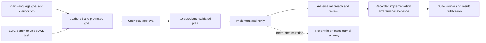

<!--
SPDX-FileCopyrightText: 2026 Whact Inc.
SPDX-License-Identifier: MIT
-->

# Crucible solution lifecycle

A solution lives in a versioned Corpus. `spec.yaml` is authoring input;
the latest valid manifest and its attached records carry execution authority.

| Stage | Workflows | Required evidence |
|---|---|---|
| Design | `goal`, `plan`, `review`, `validate` | A promoted Spec and each command's explicit source inputs. |
| Build | `architect`, `tier`, `implement`, `handoff`, `breach` | Accepted directives, current plan provenance, resolved source scope, and configured gates. Architect can establish the plan itself. |
| Benchmark | `swebench`, `deepswe` | An explicit dataset/cohort, isolated task workspaces, and suite-specific verifier inputs. |
| Recovery | `reconcile`, `journal_recover` | Exact retained run/journal state and any required operator authorization. |

The provider-free `backend_config_bind_deepseek` command prepares a bound
diagnostic route before a benchmark Corpus exists.

## Execution rules

- The design skill authors a strict Spec from a conversation, existing source,
  or an empty folder. See [authoring.md](authoring.md). The user need not write
  code or YAML. Wait for explicit approval of the goal before any planning;
  model approval cannot substitute for that decision.
- Promote authored changes before dispatch. A YAML edit alone does not update
  the latest manifest.
- Solution and benchmark planning derive three independent candidates with a
  shared budget, evaluate them adversarially, and compare them before publishing one plan.
  Any synthesis receives fresh review and validation. Retain losing and failed
  branches as evidence without granting them execution authority.
- Benchmark competitions share at most 40% of the unchanged task allowance;
  source limits are shared across planners. Each active task can issue three
  concurrent draft requests even when task scheduling is serial. An explicit
  single-track diagnostic stays identified as such. See the
  [benchmark guide](../../../docs/BENCHMARKS.md) for suite-specific reserves.
- Completed benchmark checkpoint conflicts require the suite's explicit rerun
  selection.
  During an authorized attempt, a retained DAG with a mismatched planning
  stamp is freshly planned. A matching stamp permits normal model-free plan
  reuse. Typed benchmark policy rejects exact digest reacceptance; use an
  explicit replan to request fresh planning.
- Verify plan acceptance, deterministic validation, and provenance before
  direct Tier or Implement execution. A rejected candidate is not authority.
- `implement` records one attempt; Tier and Architect own their enabled
  build, verify, breach, and review gates.
- `handoff` captures externally completed work. Preview its scope with
  `--dry-run`; record it and any requested gates before claiming completion.
- Only a typed review `decision == "pass"` approves an artifact.
- Hidden verification belongs to deterministic suite code and stays outside
  model-visible source, tools, and prompts.
- A failed or rolled-back attempt never counts as accepted implementation.
- Recovery reports exact state; it does not imply a successful build.

## Paths and reporting

The skills resolve `<workspace>/.crucible/specs/<target>/<spec>/` and compute
both the target repository and the planning context. Crucible's installation
directory is independent of that workspace. See
[preflight.md](preflight.md). `implement` uses its process current directory;
other mutating commands receive their explicit source-root option.

Normal runs retain `run_manifest.json`, `saga.json`, `summary.json`,
`result.json`, and terminal `outcome.json`. Events, model traces, and build
artifacts depend on the workflow. Child completion is saga-bound. Report the
typed terminal class, executed/skipped gates, attached refs, final Spec
version, run directory, and actual cost. Do not infer success from the
existence of a summary or from coarse run counts.

Run within the user's authorized scope. A missing prerequisite needs a
concrete diagnosis; an already authorized workflow sequence does not require
repeated approval between stages. Paid live calls and hidden evaluators need
the task's explicit route and execution authorization.
