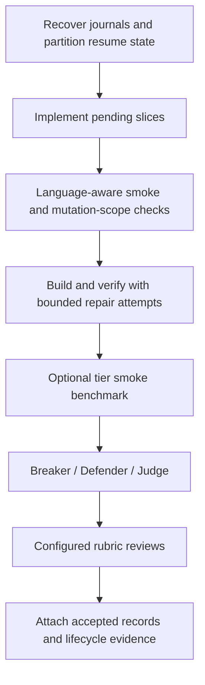

<!--
SPDX-FileCopyrightText: 2026 Whact Inc.
SPDX-License-Identifier: MIT
-->


# /crucible-build

| Intent | Workflow |
|---|---|
| Run one model implementation attempt | `implement` |
| Execute one tier through the configured gates | `tier` |
| Plan/reuse authority and walk the full DAG | `architect` |
| Capture work already completed outside Crucible | Route to `/crucible-handoff` |

Use `tier` for an explicitly named tier. Use `architect` for “execute the full
plan.” Do not implement tiers one by one merely because `tier` is more heavily
gated; architect can opt into the same breach/review coverage.

## Preflight

Locate the physical skill folder and `CRUCIBLE_DIR` through
[the shared preflight](../_shared/preflight.md), then use
`REQUESTED_STAGE=build`.

A plain-language request to implement the accepted plan selects the full DAG
path below. Do not ask the user to write a spec, commands, or code. If no Spec
exists, use `crucible-design`'s conversational authoring path. Always obtain
explicit approval of a new or materially changed goal before any planning,
including Architect's implicit planner. An already approved unchanged goal
does not need another approval.

For direct `tier` or `implement`, verify from the latest Spec and retained
provenance that:

- an executable TierDAG is present;
- its plan-contract fingerprint is current;
- deterministic validation completed unless the operator explicitly accepts
  a recorded override; and
- the selected directive exists and the resolved `$TARGET_DIR` is the intended
  repository.

For `architect`, require a promoted Spec and the intended `$TARGET_DIR`, but do
not require a pre-existing TierDAG: Architect creates one when absent. If a DAG
is retained, inspect its provenance because Architect reuses it only when the
plan contract is current or the operator explicitly authorizes re-planning or,
for an ordinary solution, exact reacceptance.

Run-directory counts are not acceptance evidence. Also inspect current Git
status and distinguish preexisting operator changes from the directive's
scope.

## One implementation attempt

`implement` has no `--cwd` flag and uses `Path.cwd()` for its mutation lock,
ToolContext, capture, and backend. Run it from the target repository:

```bash
(
  cd "$TARGET_DIR"
  uv run --project "$CRUCIBLE_DIR" crucible implement \
    --spec "$SPEC_DIR" \
    --slice <slice-id> \
    --budget-usd <per-call-usd>
)
```

The default is 50 conversational turns. This workflow runs one
`assay.implement` call, validates/captures its mutation transaction, persists
the Implementation, and keeps the workspace only for a success
classification. It does not run tier smoke, build/verify, breach, or review
gates. Report it as an attempt, not accepted tier completion.

## One tier

```bash
uv run --project "$CRUCIBLE_DIR" crucible tier \
  --spec "$SPEC_DIR" \
  --tier <tier-id> \
  --cwd "$TARGET_DIR" \
  --budget-usd <cumulative-usd>
```

The normal CLI path performs:



Implemented defaults include:

- 50 turns per slice implementation;
- 120-second language-aware smoke timeout;
- 60-minute build and verify timeouts;
- two build/verify repair attempts;
- breach enabled unless an authored raw policy or `--skip-breach` disables it;
- review enabled unless `--skip-review` is supplied; and
- shared-checkout mutation serialized even when a larger
  `--max-concurrent-slices` is requested.

Skip flags (`--skip-smoke-check`, `--skip-build-verify`,
`--skip-mutation-scope`, `--skip-smoke-bench`, `--skip-breach`,
`--skip-review`, `--no-reap`) weaken or bypass evidence. Use them only for an
explicit diagnostic and list every skipped gate in the result.

Resume skips only prior implementations whose classification, directive,
Spec/DAG identity, base commit, and dependency state match. `--restart` ignores
skip-worthy records. `--worktree` creates a fresh worktree for the tier and
implies fresh pending work after a crashed worktree run; initialize required
nested submodules in the source checkout first.

## Full DAG

```bash
uv run --project "$CRUCIBLE_DIR" crucible architect \
  --spec "$SPEC_DIR" \
  --cwd "$TARGET_DIR" \
  --enable-source-tools \
  --include-breach \
  --include-review \
  --budget-usd <cumulative-usd>
```

Architect reuses an accepted plan only when its provenance remains current.
If planning is needed, it uses three independent proposals and one shared
budget by default, with adversarial evaluation and fresh gates for any
synthesis. Goal approval remains a prerequisite. Do not silently reduce the
planner count to fit a budget; report insufficient budget or an incomplete
competition instead.
For ordinary solutions, use `--replan` to authorize replacement, or
`--reaccept-plan-digest sha256:<hex>` to reaccept the exact retained DAG under
current validation/provenance without calling planning models. These options
are mutually exclusive.

Architect validates before implementation by default and halts on blocking
findings. `--replan-on-validate-fail` authorizes a repair plan;
`--skip-validate` bypasses the gate and must be reported. Build/verify is on by
default. Unlike direct `tier`, breach and review are architect CLI opt-ins;
include both for the fully gated path.

`--stop-after-tier` is an intentional partial checkpoint. A zero process exit
in that mode is not full-DAG completion; report the partial status and
remaining tiers.

## Concurrency, recovery, and budget

- One checkout has one mutation authority at a time. Requested concurrency is
  useful only across isolated roots; it never authorizes interleaved writes to
  the same checkout.
- Keep journal recovery and the orphan reaper enabled unless preserving a
  failed workspace for forensics. Use direct `crucible reconcile` for normal
  deterministic recovery and `journal_recover` only with exact external
  authorization.
- Tier and architect budgets are cumulative across model roles and child
  stages. Do not multiply the cap per role.
- For benchmark execution, use the suite runner described in the
  [benchmark guide](../../../docs/BENCHMARKS.md). Its three planners share at
  most 40% of the same task budget, with task-wide source limits. Account for
  three nested draft requests per active task. A changed benchmark planning
  identity requires a fresh plan during an authorized attempt. A matching stamp
  permits normal plan reuse; typed benchmark policy rejects exact digest
  reacceptance. DeepSWE's `--replan` or programmatic Architect's `replan=True`
  requests fresh planning.
- Planner, reviewers, and mutating roles resolve independently through the
  routing registry. Confined roles receive only their classified ToolSets;
  adapter-native executors remain disabled on scoped mutation paths.

## Report

Report the top-level run, saga-bound child runs, typed terminal status,
published Spec version, Implementation/Verdict/lifecycle refs, final canonical
diff, workspace state, executed/skipped gates, partial status, and cumulative
cost. Never call a rolled-back mutation, provisional record, or summary-only
result “landed.”
