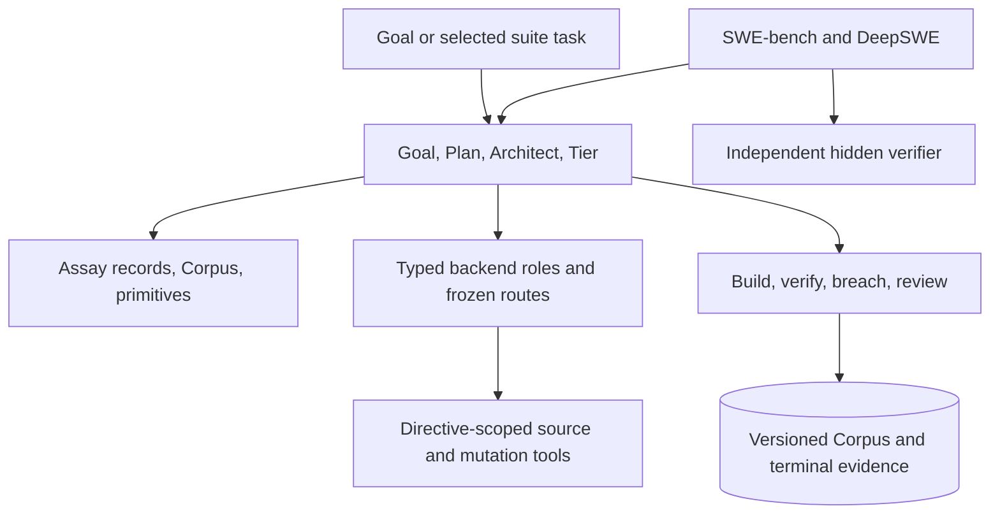
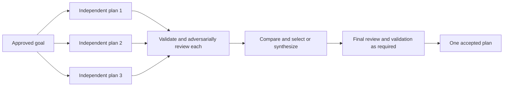

<!--
SPDX-FileCopyrightText: 2026 Whact Inc.
SPDX-License-Identifier: MIT
-->

# Crucible architecture

Crucible turns an explicit problem into a verified candidate solution. The
reusable pipeline supports ordinary repository work and two benchmark adapters:
SWE-bench Verified and DeepSWE.

## Components

| Component | Responsibility |
|---|---|
| Assay | Typed contracts, canonical records, Corpus, generic planning/review/implementation/validation primitives. |
| `workflows/` | Bounded commands, policies, orchestration, durable outcomes, rollback, and recovery. |
| `backends/` | Closed role routing, capability checks, vendor transports, limits, cost and trace evidence. |
| `tools/` | Explicit source/write/build tools, scoped by role and directive. |
| `common/` | Runners, execution containment, evidence, quotas, and shared runtime support. |
| `rubrics/` and `rules/` | Typed adversarial reviews and deterministic plan checks. |
| `products/swebench/` and `products/deepswe/` | Dataset selection, isolated workspaces, suite policy, candidate capture, and independent verification. |

## Durable solution authority

`spec.yaml` is authoring input. Promotion creates a canonical Spec version;
`Corpus.latest_spec()` reads the highest valid manifest. Planning publishes an
accepted TierDAG together with review, validation, and source provenance.
Rejected candidates never become executable plan authority.

Record-producing commands open private run envelopes. `run_manifest.json`
binds the process and input identity; `saga.json` binds child operations;
`summary.json` reports progress; immutable `result.json` and typed
`outcome.json` describe terminal completion. Content-addressed record refs and
Spec transitions publish transactionally. Diagnostics do not replace authority.

## Execution and adversarial iteration

Architect establishes or reuses current plan authority and walks tiers in
topological order. Tier executes scoped directives and its enabled smoke,
build/verify, breach, and review gates. Implement records one model attempt.
Handoff captures externally completed work using the same scope and evidence
contracts. Breach separates attack specification, isolated test authoring,
pre-fix execution, production repair, post-fix execution, and adjudication.

Models author proposals and code. Workflow code executes deterministic gates.
Review uses `assay.review.v2`; only `decision == "pass"` approves. Source
artifacts, prior findings, generated proposals, and executed observations have
distinct evidence roles. Truncated, missing, or unverifiable required evidence
cannot silently become approval.

## Parallel work

Plan, Architect, SWE-bench, and DeepSWE default to three independently generated
complete proposals. Each draft has a fresh backend/session and reads the same
source snapshot, excluding Corpus and control outputs. Planners cannot inspect
sibling drafts. Deterministic checks and independent Critic/Judge reviews run
against the actual target. Comparison can select an eligible proposal or
propose a complete synthesis; synthesis always receives fresh acceptance gates.
Only the owning workflow publishes the final executable DAG.

One explicit finite budget covers drafts, candidate reviews, comparison, and
synthesis review. Disjoint allowances limit new calls; provider enforcement is
reported honestly as a soft ceiling where applicable. Missing accounting,
unsettled children, budget overruns, or source changes block acceptance. Retain
all branch evidence and costs, including rejected drafts. Goal approval is the
interactive design skill's prerequisite, separate from model review decisions.
The publication owner rechecks the frozen source identity under the Corpus
lock before making a plan executable, including candidates with no citations.

Read-only orchestration children receive independent backends, tools, contexts,
source authority, budgets, and cancellation state. Parents join children before
consuming results. Source-discovery ceilings apply across the shared planning
operation, including children and correction attempts.
The opt-in analysis fan-out feeds one planner and remains a distinct mode from
competing complete plans. An explicit planner count of one selects the bounded
single-track path. Diagnostic cost pilots require that explicit choice.

Each benchmark task keeps one total budget. Its competing drafts, candidate
reviews, comparison, and synthesis gates share at most 40% of that task budget,
further bounded by remaining task funds and any stricter development ledger.
The competition's stage shares divide this planning allowance. DeepSWE retains
its implementation/verifier reserve and contingency. Source-discovery limits
also remain task-wide rather than multiplying by the planner count. Provider
responses retain the enforcement strength declared by their adapter.

SWE-bench's instance-worker count and DeepSWE's serial task loop control task
scheduling. Each active task can still issue three concurrent draft requests;
convergence limits on active task cells do not serialize those nested requests.
Plan alternatives read frozen source; implementation and hidden verification
retain their existing isolation contracts.

Tier's optional isolated-writer fan-out allocates a separate checkout, journal,
and backend to each lane. Requests must bind exact directive scopes. Integration
uses deterministic request order and one owning Tier landing transaction.
Incompatible gate/runner configurations fail before writing. Concurrent writes
to one shared checkout are never authorized merely by a concurrency count.
Supported entrypoints live in [orchestration.py](../orchestration.py).

## Routes, tools, and limits

The closed `crucible.backend-routing.v1` schema rejects unknown roles, fields,
adapters, and unsupported features. Each role has a maximum capability: text,
read-only, or workspace write. The resolved route and pricing identity remain
frozen throughout nested benchmark execution. Requested/served model and
runtime identities, prompt/schema/tool/policy identities, and session behavior
remain attributable. There is no automatic provider or model substitution.

Backend-private MCP bridges and function-calling loops carry only attached
Crucible ToolSets. Confined processes ignore ambient hooks, plugins, skills,
settings, and tools. Writable paths come from the typed directive; model text
cannot broaden them. Adapter-native executors remain disabled for confined
writers.

Limits declare their enforcement strength. Aggregate workflow cost and
per-instance budgets are distinct from hard provider-side invocation limits.
Explicit diagnostic cost intervals support only their admitted uncertainty;
they never become exact actual charges or promotable benchmark evidence.

## Mutation and recovery

A durable journal captures pre-mutation bytes, modes, symlinks, index state,
and lineage. Locks serialize writers sharing Git or root identity. Rollback,
reconciliation, and exact journal recovery require settled writer generations.
A dead PID or caught timeout does not establish quiescence. Armed or malformed
settlement evidence blocks capture, restore, commit, and cleanup.

Supervised runners prove READY before the controller arms an exact epoch and
sends START. Cancellation and terminal receipts bind the same launch/epoch.
Unknown or incomplete settlement stays blocking. Storage bounds apply to
untrusted writable growth; required quota support fails closed when unavailable.

## Benchmark validity

Each task has a separate Corpus, source checkout, budget assignment, and
container identity. Public development tests support authoring. Candidate
capture enforces suite patch rules and retains exact bytes. Pristine visible
verification replays the candidate independently. Hidden material is exposed
only to deterministic verifier code, never authoring models.

SWE-bench publishes leaderboard-shaped predictions and official harness
outcomes. DeepSWE publishes verifier evidence and binary rewards. Cascade
return codes, diagnostic route success, and plausible patches remain distinct
from solved-task truth. Resume validates recipe, route, dataset, policy,
container, and candidate identities before reuse.

Benchmark planning also carries a frozen identity for planner count, budget
share, execution fingerprint, and planning source recipe. Its lifecycle stamp
binds the exact accepted plan terminal and DAG. A matching stamp permits normal
plan reuse without planning calls. A retained DAG without that current stamp
must be freshly planned once task execution is authorized. Typed benchmark
policy rejects exact digest reacceptance; an explicit replan requests fresh
planning. A completed checkpoint identity conflict
still requires the suite's explicit rerun selection before another attempt.
Historical single-track results and route qualification remain attributable
to their original recipe.

See the [workflow references](workflows/README.md),
[public API](PUBLIC_API.md), and [design axioms](../DESIGN_AXIOMS.md).
