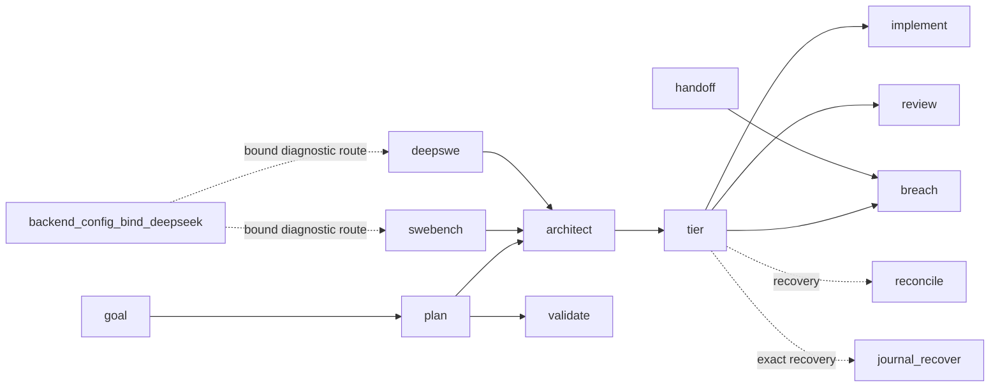

<!--
SPDX-FileCopyrightText: 2026 Whact Inc.
SPDX-License-Identifier: MIT
-->

# Workflow reference

The 14 workflows support solution design, implementation, adversarial review,
benchmark execution, explicit route preparation, and recovery. Each command is
one module exporting `main(argv) -> int`; the filesystem dispatcher is the
inventory authority.

```bash
uv run crucible --list
uv run crucible <workflow> --help
```



| Workflow | Purpose |
|---|---|
| [architect](architect.md) | Build a complete solution. |
| [backend_config_bind_deepseek](backend_config_bind_deepseek.md) | Bind a DeepSeek diagnostic route. |
| [breach](breach.md) | Adversarially challenge a candidate. |
| [deepswe](deepswe.md) | Run DeepSWE. |
| [goal](goal.md) | Refine a solution goal. |
| [handoff](handoff.md) | Record interactive implementation. |
| [implement](implement.md) | Record one implementation attempt. |
| [journal_recover](journal_recover.md) | Recover one exact retained mutation. |
| [plan](plan.md) | Derive and adjudicate an executable plan. |
| [reconcile](reconcile.md) | Reconcile durable solution state. |
| [review](review.md) | Review an explicit artifact. |
| [swebench](swebench.md) | Run SWE-bench Verified. |
| [tier](tier.md) | Execute and gate one tier. |
| [validate](validate.md) | Validate an accepted or candidate Spec. |

The built-in model route is Codex `gpt-6-astra` with `max` reasoning. An explicit
closed routing file replaces or overrides it. Routes freeze across nested
cascades; unsupported capabilities fail before transport.

Implement, Tier, Breach, and Architect end as `setup_error` (exit `2`) before
any model call when a role that writes routes to Codex, Claude, DeepSeek, or
Kimi and the source root holds a directory, or a link to one, named like that
root. For a Spec whose paths are relative to that root, run Tier or Architect
with `--worktree`, or give the checkout directory another name. For a Spec
planned from the directory above that root (it writes `<name>/<path>` for
`<path>` in the root), use neither: both read `<name>/<path>` as a path below
`<name>/`, and a write creates files there. Such a Spec runs only after it is
planned again relative to the root.

Most commands consume a promoted Corpus through `--spec`. Route binding runs
before the Corpus exists. Journal Recovery acts on an exact retained journal.
Normal run envelopes bind manifests, sagas, summaries, immutable results, and
typed terminal outcomes. A process exit is workflow-specific: benchmark
aggregate scheduling, child implementation, and hidden verification are
separate results.

See [architecture](../ARCHITECTURE.md), [public API](../PUBLIC_API.md),
[shared lifecycle](../../.claude/skills/_shared/lifecycle.md), and
[test guide](../../tests/TEST_BASELINE.md).
